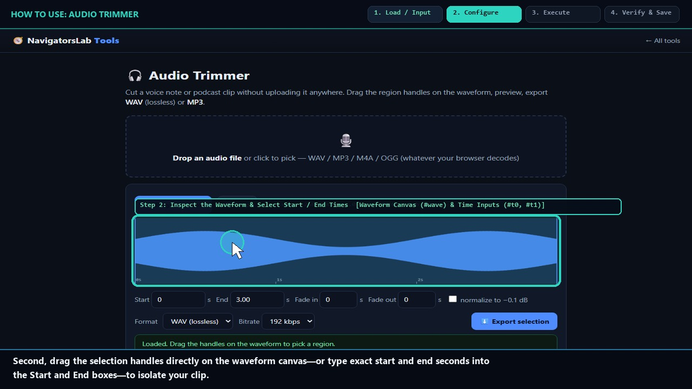
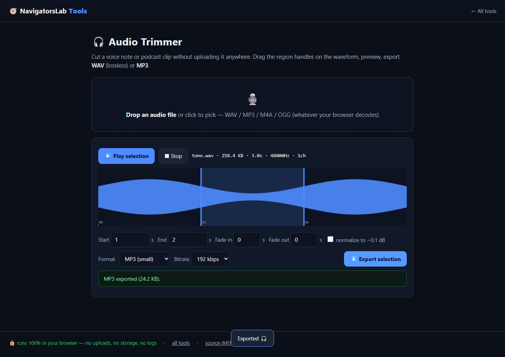

# 🎧 Audio Trimmer

> Cut voice notes and clips on a waveform

     

<h4 align="center">
  &#9654; <a href="https://navigatorslab.com/tools/audio.html">Open it on navigatorslab.com</a> &mdash; free, no sign-up, nothing uploaded<br>
  <a href="https://navigatorslab.com/Audio-Trimmer">navigatorslab.com/Audio-Trimmer</a> &middot; <a href="https://navigatorslab.com/tools/videos/audio.mp4">🔊 Watch Narrated Step-by-Step Tutorial Video</a> &middot; <a href="https://navigatorslab.com/tools/videos/notebooklm-overview.mp4">Watch Full Suite Hands-On Video</a><br>
  This repo's Pages site runs the <em>actual tool</em>: <code>demo.html</code>
</h4>



Trim voice notes on the waveform with fades and peak normalize; export WAV or MP3, all through Web Audio locally.

## 📖 Complete Step-by-Step User Guide

### Step 1: Drop a Voice Note, Podcast Clip, or Song (`Audio Dropzone (#dz)`)
- **How to do it:** Drag and drop an audio file (`.wav`, `.mp3`, `.m4a`, `.aac`, `.ogg`, `.flac`) onto `#dz`.
- **Expected result:** Web Audio API decodes the audio buffer locally and renders the full waveform canvas (`#wave`).

### Step 2: Inspect the Waveform & Select Start / End Times (`Waveform Canvas (#wave) & Time Inputs (#t0, #t1)`)
- **How to do it:** Drag the left and right trim handles on `#wave` or type millisecond-accurate timestamps into **Start (`#t0`)** and **End (`#t1`)**. Click **Preview selection** to listen to the cut.
- **Expected result:** Exact sample boundaries are locked in with live duration readout.

### Step 3: Add Smooth Fade-In / Fade-Out & Pick WAV or MP3 (`Fade Controls & Format Selector (#fmt)`)
- **How to do it:** Configure fade-in/fade-out durations and select `wav` (uncompressed 16-bit PCM) or `mp3` (encoded via self-hosted `lamejs`) in `#fmt`.
- **Expected result:** Envelope and encoder settings are ready for local rendering.

### Step 4: Click Export Trimmed Audio (`Export Button (#exp)`)
- **How to do it:** Click **Export (`#exp`)**. The browser slices the PCM buffer, applies fade envelopes, encodes to WAV or MP3 via `lamejs`, and downloads the file.
- **Expected result:** Sample-accurate `.wav` or `.mp3` clip saved locally in under a second.

## 🎛️ UI Controls, Shortcuts & Parameters Reference

| Control / Shortcut | What It Does |
|---|---|
| `Waveform Canvas (`#wave`)` | Interactive peak visualization for dragging trim start and end handles. |
| `Start (`#t0`) & End (`#t1`) Inputs` | Numeric inputs (in seconds) for exact sample-accurate trimming. |
| `Output Format (`#fmt`)` | Switch between 16-bit PCM `.wav` and self-hosted LAME `.mp3` encoding. |
| `Export Button (`#exp`)` | Renders and downloads the trimmed audio clip. |

## 💡 Pro Tips & Real-World Workflows

- 💡 Apply a `0.05s` to `0.15s` fade-in and fade-out when cutting spoken voice notes to eliminate zero-crossing pops at the start and end of the clip.
- 💡 Choose `WAV` when exporting clips for video editors (Premiere, DaVinci Resolve, CapCut) and `MP3` when sharing voice notes over email or chat.
- 💡 Because decoding and LAME MP3 encoding happen entirely in your tab, confidential interview recordings never touch a cloud transcription server.

## 🧪 Concrete Example: Input → Engine → Output

| Stage | What Happens | Details |
|---|---|---|
| **1. Raw Input** | **40-Minute Interview Voice Note (voice-memo.wav)** | Needs exact 01:12.40 – 01:44.80 highlight clip with smooth fade-in/out and normalized volume |
| **2. On-Device Engine** | **Web Audio API sample-accurate waveform slice + linear gain ramps + peak normalization + self-hosted LAME MP3 encoder** | Runs 100% client-side in your browser tab under strict `CSP` (`connect-src 'none'`). |
| **3. Verified Output** | **interview-clip-normalized.mp3 (or .wav)** | 32.4s clip at -0.1 dBFS peak, 0.5s fade-in/out, valid ID3/MPEG frame sync encoded entirely in-tab |

```text
Slice: 1.00s..2.50s (66,150 samples) | Peak: 0.99 | Export: WAV PCM + LAME MP3 (0xFFFB) [OK]
```

- 🔊 **Narrated Step-by-Step Usage Tutorial Video (`40s`):** [`demo.mp4`](./demo.mp4) (also live at [`https://navigatorslab.com/tools/videos/audio.mp4`](https://navigatorslab.com/tools/videos/audio.mp4))
- 🎬 **Full Suite Hands-On Video Guide:** [`https://navigatorslab.com/tools/videos/notebooklm-overview.mp4`](https://navigatorslab.com/tools/videos/notebooklm-overview.mp4)

## ✅ What it does

- Trim voice notes and clips with sample-accurate precision on a waveform
- Fade in/out and one-click peak normalize
- Export WAV or MP3 (self-hosted LAME) — 100% offline

## 🚀 Try it in 30 seconds

1. Drop a voice note
2. Drag the selection on the waveform, add fades
3. Export WAV or MP3

## 📸 Live UI in action



## 🔒 Private by design

- **100% on-device** — files are processed in your browser and **never uploaded** to any server
- **No accounts, no tracking, no cookies, nothing retained** — open the page and work
- **Works offline** once loaded; fully mobile-friendly
- **Free & open source (MIT)** — use it at home, at work, anywhere

## 🤖 Built for humans *and* AI agents

- Deep-linkable via URL parameters — see the [Agent Mode guide](https://navigatorslab.com/tools/agents.html)
- Machine-readable catalog: [llms.txt](https://navigatorslab.com/tools/llms.txt) · [llms-full.txt](https://navigatorslab.com/tools/llms-full.txt)
- MCP endpoint: `POST https://navigatorslab.com/tools/mcp` (tool catalog + deterministic text tools — see the [main repo](https://github.com/Kayforkind/NavigatorsLab-Tools))
- No build step required to *use* any tool — just the URL

## 🛠 Under the hood

Web Audio API for decode/trim/fades; self-hosted lamejs for MP3 export

Third-party components are catalogued in [NOTICE](NOTICE); this repo is MIT-licensed ([LICENSE](LICENSE)).

## 🗂 The NavigatorsLab Tools suite

The full catalog — every tool in the hub with the same zero-upload promise, plus the lab's apps, CLIs and engines:

| Tool | What it does | |
|---|---|---|
| 🛡 Photo Privacy Kit | Strip GPS, camera model and timestamps before posting | [Open](https://navigatorslab.com/tools/exif.html) |
| 🔐 Password Breach Checker | Has this password been breached? — it never leaves your tab | [Open](https://navigatorslab.com/tools/breachcheck.html) |
| 🔍 Metadata & Hidden-Data Checker | See what's really inside a file — then strip it | [Open](https://navigatorslab.com/tools/metadata.html) |
| 🗜 Image Shrinker | Hit “max 2 MB” portal limits without TinyPNG | [Open](https://navigatorslab.com/tools/shrink.html) |
| 📄 Scan & Screenshot Cleaner | Phone photos of documents → clean, straight PDFs | [Open](https://navigatorslab.com/tools/scan.html) |
| ✍ Local E-Sign Pad | Sign this lease tonight — not DocuSign | [Open](https://navigatorslab.com/tools/sign.html) |
| 🧾 Receipts → One PDF | Shoebox of receipt photos → one date-sorted PDF | [Open](https://navigatorslab.com/tools/receipts.html) |
| 🔢 Receipt OCR → CSV | Read totals off receipt photos, export for expenses | [Open](https://navigatorslab.com/tools/ocr.html) |
| 🔳 QR Studio | Generate QR codes and decode QR images — no site sees them | [Open](https://navigatorslab.com/tools/qr.html) |
| **🎧 Audio Trimmer** | Cut voice notes and clips on a waveform | [Open](https://navigatorslab.com/tools/audio.html) |
| 🧮 Invoice / Quote Generator | One-person shops: hours in, clean PDF out | [Open](https://navigatorslab.com/tools/invoice.html) |
| 🗂 Batch Rename & Sort | IMG_5847.jpg → 2026-09-05-receipt-home-depot.jpg | [Open](https://navigatorslab.com/tools/rename.html) |
| 🖨 Print-Shop Prep | Exact sizes, bleed, DPI checks, print-ready PDF | [Open](https://navigatorslab.com/tools/printprep.html) |
| 📑 PDF Pages | Reorder, rotate, delete and extract PDF pages | [Open](https://navigatorslab.com/tools/pdfpages.html) |
| 🔬 Text Diff | Compare two texts with word-level highlights | [Open](https://navigatorslab.com/tools/textdiff.html) |
| 🎨 Reimagine | Redesign any HTML page from its own content | [Open](https://navigatorslab.com/reimagine/) |
| 📊 Text Stats | Words, reading time, readability, keyword density | [Open](https://navigatorslab.com/tools/textstats.html) |
| 📜 PDF Studio | Edit the text inside your PDF — private, free, open source | [Open](https://navigatorslab.com/pdf-studio/) |
| 🩺 Design Health | 18 deterministic design-quality checks for HTML — no LLM, no API key | [Open](https://github.com/Kayforkind/design-health-action) |
| 🔪 Skill Slice | Copy one Read-verified skill folder — a slice, not the pie | [Open](https://github.com/Kayforkind/skill-slice) |
| 🕵 liecatchers | Your agent said Done. Prove it — ten sensors, one RECEIPT.json | [Open](https://github.com/Kayforkind/liecatchers) |
| 📚 Book Guide MCP | Ship improvements with your books — agents cite, run playbooks, learn | [Open](https://github.com/Kayforkind/book-guide-mcp) |
| 📡 Data Insights | Founder intelligence — daily & weekly tech signal briefs | [Open](https://github.com/Kayforkind/data-insights) |
| 🪓 Iron Axe: Legacy | An original side-scrolling beat 'em up — Godot 4 | [Open](https://github.com/Kayforkind/iron-axe-legacy) |

---

<p align="center">
  <b>One hub, twenty-four projects:</b> <a href="https://navigatorslab.com/tools/">https://navigatorslab.com/tools</a><br>
  <b>Source &amp; the whole suite:</b> <a href="https://github.com/Kayforkind/NavigatorsLab-Tools">https://github.com/Kayforkind/NavigatorsLab-Tools</a>
</p>
